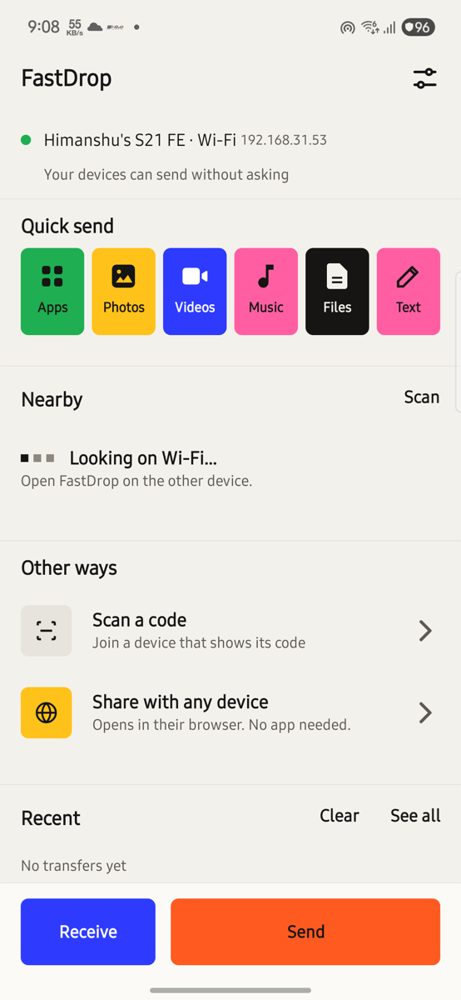
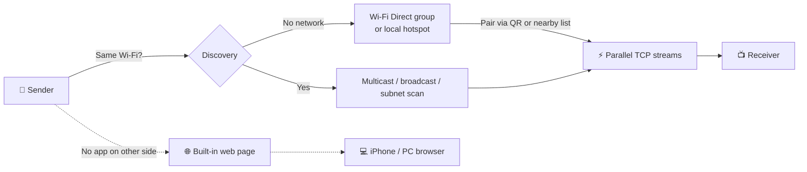

<div align="center">

# ⚡ FastDrop

**Fast, offline file sharing between Android phones, Android TVs, Macs, PCs and any device with a browser.**

No internet. No accounts. No cloud. Just open it on both devices and tap.

[](#-install)
[](https://kotlinlang.org)
[](#-notes)
[-success)](#-tech-stack)
[](LICENSE)
[](https://github.com/himanshudev28/FastDrop/releases/latest)
[](https://github.com/himanshudev28/FastDrop/actions/workflows/release.yml)



</div>

---

## ✨ Why FastDrop?

| | |
|---|---|
| 🚀 **Fast** | ~**46 MB/s** phone → Mac and ~**35 MB/s** Mac → phone over a 5 GHz hotspot (measured on a Galaxy S21 FE). |
| 📡 **Works offline** | Same Wi‑Fi? Devices find each other automatically. No Wi‑Fi at all? FastDrop builds its own direct link with Wi‑Fi Direct or a local hotspot. |
| 📺 **TV‑ready** | Runs on Android TV with full D‑pad navigation, a built‑in file browser, and a "Show my QR" flow for TVs without cameras. |
| 🌐 **Any device** | iPhone, PC or a phone without the app? **Share with any device** turns your phone into a tiny web server they can open in a browser. |
| 🪶 **Tiny** | Tiny APK. No AndroidX. One library (ZXing for QR codes). Runs back to Android 5.0. |
| 🔒 **Private** | Files go straight from one device to the other on your local network. Nothing is uploaded anywhere. |
| 🔁 **Resumes** | Interrupted transfers pick up where they stopped. Only the missing chunks are sent again. |
| ✅ **Trusted devices** | Tick "Always accept from…" once and that device can send without a prompt. New senders show a 4‑digit confirmation code on both screens. |
| 💬 **Text, links & clipboard** | Send a message, a link or your clipboard to another device, not just files. |
| 👥 **Send to several** | Pick multiple devices and send to all of them in one go. |
| 🕘 **History** | A persistent list of what you sent and received, with Copy and Open for text. |
| 🎯 **Shortcuts** | Direct Share targets in the system share sheet, a Quick Settings tile and a home‑screen widget. |
| 🧮 **Optional CRC32 check** | Verify every chunk when you want extra certainty (off by default, to stay fast). |
| 🎨 **System / Light / Dark** | The new "Signal" look follows your system theme, or you can pick one. |
| 💻 **Mac & PC** | A native Mac app (Apple silicon and Intel) and a Windows/Linux/macOS command‑line client. |

> 💡 **Tip:** use a **5 GHz hotspot or Wi‑Fi** for full speed. 2.4 GHz tops out at about 11 MB/s.

## 🖥 Platforms

| Platform | What you get |
|---|---|
| 📱 **Android phones** and 📺 **Android TVs** | The full app, with D‑pad navigation on TV. Android 5.0+. |
| 🍎 **Mac** (Apple silicon and Intel) | A native app with a menu bar item, Finder **Services** ("Send with FastDrop"), and drag‑and‑drop onto the menu‑bar icon. See [`mac/README.md`](mac/README.md). |
| 💻 **Windows / Linux / macOS CLI** | [`tools/fastdrop.py`](tools/fastdrop.py), a single file that needs only the Python standard library. See [`tools/README.md`](tools/README.md). |
| 🌐 **Any browser** | iPhone or any device without the app can use **Share with any device**. |

---

## 📦 Install

The APK and the Mac app (`FastDrop-mac.dmg`, or `FastDrop-mac.zip`) come from the **[⬇️ latest Release](https://github.com/himanshudev28/FastDrop/releases/latest)**. You can also [build it yourself](#-build-from-source).

### 📱 Android phone or TV
1. Download `FastDrop.apk`, copy it to the phone or TV and open it, or run:
   ```bash
   adb install FastDrop.apk
   ```
2. **On a TV:** put the APK on a USB stick and install it with a file manager, or use `adb` over the network.

### 🍎 Mac
1. Download `FastDrop-mac.dmg`, open it, and drag **FastDrop** onto **Applications**. (Prefer a zip? `FastDrop-mac.zip` has the same app.)
2. The first time, **right‑click → Open** (then **Open** again). The app isn't notarized, so a double‑click is blocked by Gatekeeper.
3. Allow **Local Network** access when macOS asks.

### 💻 Windows / Linux PC
Use the command‑line client. See [`tools/README.md`](tools/README.md) for setup, firewall rules and examples.

> 💡 **Share the app without internet:** open **Settings → Share FastDrop app** and let your friend scan the codes. Their phone downloads the APK straight from yours.

---

## 🚀 How to use

### 📤 Send
1. Tap **Send** and pick **Apps, Photos, Videos, Music or Files**, or use **Share → FastDrop** from any app.
2. Devices on the same Wi‑Fi appear at the top automatically. Devices nearby over Wi‑Fi Direct are listed below them.
3. Tap a device, or tap **Scan QR** and scan the code on the receiver's screen.

### 📥 Receive
- FastDrop receives whenever it's open, and senders on the same Wi‑Fi see you automatically.
- Tap **Receive** to also show a QR code and become visible over Wi‑Fi Direct, for senders that aren't on your network.
- Accept the incoming files. They're saved to `Download/FastDrop`, and you can install received apps from **Recent**.

### 📺 TV without a camera
On the TV, go to **Send → Show my QR**. On the phone, go to **Receive → Scan sender's QR**. The phone joins the TV's network and the TV sends to it.

### 🌐 Share with a device that doesn't have FastDrop
Tap **Share with any device**. The other device joins the Wi‑Fi in the first QR code, then opens the web page in the second QR code to download or upload files in its browser.

> 🔎 **Device not showing up?** Try **Find on network**, **Enter IP**, or use the QR code.

---

## 🧭 How it connects



## ⚡ What makes it fast

- **Plain TCP, no TLS:** weak TV processors don't become the bottleneck.
- **Parallel streams:** 4 by default (1–8 in Settings), with large socket buffers and zero‑copy sending.
- **A smart offline link:** a Wi‑Fi Direct group on 5 GHz where possible, matched to the receiver's Wi‑Fi channel so the radio doesn't switch between two channels. On Android 10+ the sender joins from the QR code with no system pop‑up.
- **The radio stays at full speed:** Wi‑Fi low‑latency/high‑performance locks, a wake lock, and a foreground service keep it there during transfers.
- **Many ways to find devices:** multicast, broadcast, a subnet scan, manual IP, Wi‑Fi Direct service discovery, and QR codes.

---

## 🛠 Build from source

**Requirements:** JDK 17 and the Android SDK (compileSdk 36).

```bash
git clone https://github.com/himanshudev28/FastDrop.git
cd FastDrop
echo "sdk.dir=$HOME/Library/Android/sdk" > local.properties   # point to your SDK
./gradlew assembleRelease
```

The APK is written to `app/build/outputs/apk/release/app-release.apk`.

> ⚠️ Local release builds are signed with your **debug key** so they install directly. Use your own signing config before you publish to a store.

### 🚢 Releasing (GitHub Actions)

[`.github/workflows/release.yml`](.github/workflows/release.yml) builds the APK and publishes it to **Releases** with a SHA‑256 checksum and auto‑generated notes.

```bash
# 1. bump versionCode / versionName in app/build.gradle.kts (e.g. 2.1)
git commit -am "Release 2.1"
git tag v2.1            # tag must match versionName
git push && git push --tags
```

Signing comes from repository secrets: `KEYSTORE_BASE64`, `KEYSTORE_PASSWORD`, `KEY_ALIAS` and `KEY_PASSWORD`. Every release must use the same key, otherwise it won't install as an update. You can also start the workflow by hand from the **Actions** tab. A manual run attaches the APK to the run as an artifact and doesn't create a release.

---

## 🔐 Security

- **Transfers aren't encrypted, by design.** FastDrop uses plain TCP so weak TV processors don't become the bottleneck.
- **Trusted devices** use a pairing key. Offers from a trusted sender are HMAC‑signed, so a device can't pretend to be one you trust. New senders always get a prompt with a 4‑digit confirmation code. You can remove a trusted device at any time in Settings.
- **Use FastDrop on networks you trust.** Avoid public Wi‑Fi. Details are in [`docs/PROTOCOL.md`](docs/PROTOCOL.md).

---

## 🧪 Test from a Mac or PC

[`tools/fdtest.py`](tools/fdtest.py) speaks the same protocol. It uses only the Python standard library.

```bash
python3 tools/fdtest.py hello <phone-ip>                         # handshake
python3 tools/fdtest.py send  <phone-ip> file1 file2 --streams 4 # send files
python3 tools/fdtest.py recv  --auto                             # your computer shows up as a device in the app
```

---

## 🗂 Project structure

```
app/src/main/java/com/fastdrop/app/
├── MainActivity.kt        # entry point, screen navigation
├── HomeScreen.kt          # home, radar, device list
├── SendScreen.kt          # pickers & target selection
├── Server.kt / Sender.kt  # TCP transfer protocol (parallel streams)
├── Discovery.kt           # multicast / broadcast / subnet discovery
├── P2pLink.kt             # Wi‑Fi Direct groups & service discovery
├── HotspotLink.kt         # local‑only hotspot fallback
├── WebShareScreen.kt      # browser share for devices without the app
├── TransferService.kt     # foreground service + Wi‑Fi/wake locks
├── Qr*.kt                 # QR generate & scan (ZXing)
└── ...                    # theme, animations, sheets, storage
mac/                       # native SwiftUI Mac app
tools/fastdrop.py          # Windows/Linux/macOS command-line client
tools/fdtest.py            # desktop protocol test client
docs/                      # PROTOCOL.md, DESIGN.md, release notes
```

## 🧰 Tech stack

- **Kotlin** with Android framework views. No AndroidX and no Jetpack, which keeps the APK tiny and old TVs supported.
- **[ZXing core](https://github.com/zxing/zxing)** for encoding and decoding QR codes.
- **minSdk 21** (Android 5.0) · **targetSdk 35** · **compileSdk 36**

---

## 📝 Notes

- **Permissions are asked only when needed:**
  - Nearby Wi‑Fi devices (or Location on Android 12 and older) for Wi‑Fi Direct.
  - Camera for scanning QR codes.
  - Photos/Videos/Music for the pickers.
  - "Install unknown apps" for installing received APKs.
- **Targets Android 15 (API 35).** Before targeting Android 17, add the new local‑network permission request.
- **Status:** same‑network discovery and transfers have been verified on a real device, with matching file hashes. Wi‑Fi Direct between two phones and D‑pad use on a physical TV still need real‑device testing. Bug reports are welcome!

## 🤝 Contributing

Issues and pull requests are welcome. If you test FastDrop on a device combination that isn't covered yet (two phones over Wi‑Fi Direct, a real Android TV), please open an issue with your results.

## 📄 License

Released under the [MIT License](LICENSE). You're free to use, modify and share it.

<div align="center">

Made with ⚡ by [@himanshudev28](https://github.com/himanshudev28)

</div>
